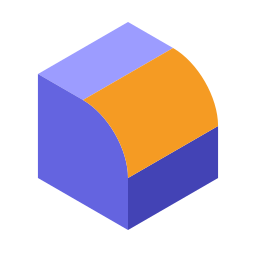
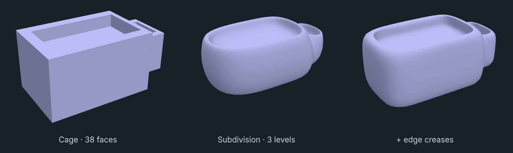

<div align="center">



# BlockSmooth

**Subdivision surfaces, edge creases and smooth shading for Blockbench meshes.**

A Blockbench plugin that does what Blender's Subdivision Surface and Smooth by Angle modifiers do,
without destroying anything. You model a coarse low-poly cage; the viewport shows the smooth result
live, every export contains it, and the `.bbmodel` keeps the cage you can keep editing.

[](https://github.com/RenasDemirbas/BlockSmooth/actions/workflows/ci.yml)
[](https://github.com/RenasDemirbas/BlockSmooth/releases/latest)
[](LICENSE)


**[Install](#install)** · **[What you get](#what-you-get)** · **[Use](#use)** ·
**[How it works](#how-it-works)** · **[Changelog](CHANGELOG.md)**



</div>

---

## What you get

- **Catmull-Clark subdivision** with separate viewport and export levels: model light, export dense.
- **Edge creases** from 0 to 1. A crease of 1 keeps an edge perfectly sharp; 0.3–0.7 gives a tight
  rounded bevel without extra edge loops.
- **Smooth by Angle and Mark Sharp.** The shading is smooth, but edges folded more than an angle,
  and edges you mark, stay crisp. This works on unsubdivided meshes too.
- **Live in the viewport.** The smooth surface follows vertex drags, every edit-mode tool, undo,
  textures and UVs, view modes, the selected-face highlight and armature animation. Skinned meshes
  deform smoothly.
- **In every export.** OBJ, FBX, glTF/GLB (including skinned glTF), Collada and STL get the
  subdivided mesh with smooth normals split at sharp edges. The `.bbmodel` keeps the cage.
- **Textures stay put.** UVs are interpolated linearly inside each cage face, so a painted texture,
  pixel art included, lands where you painted it.
- **Lean on the GPU and in files.** The viewport draws shared vertices: about one GPU vertex per
  surface point instead of four per quad, 2.6–3.2× fewer. glTF exports are welded the same way.
  OBJ and FBX exports share vertices too, and split them only where the shading is sharp.
- **Apply** when you need the dense mesh itself. UVs, textures, bone weights, seams and sharp marks
  carry over.
- **Scriptable.** `window.BlockSmooth` for scripts and other plugins. The
  [Blockbench MCP](https://github.com/RenasDemirbas/BlockBenchMCP) bridge uses it in its
  `smooth_mesh` tool, so an AI assistant can model smooth meshes too.

## Install

**1. Get the plugin.** Download `blocksmooth.js` from the
[latest release](https://github.com/RenasDemirbas/BlockSmooth/releases/latest).

**2. Load it.** In Blockbench: **File → Plugins → ⋮ → Load Plugin from File**, pick
`blocksmooth.js`, accept the prompt.

It needs Blockbench 5.2 or newer and a format with meshes (Generic Model, "free").

<details>
<summary><b>Build from source</b></summary>

```bash
git clone https://github.com/RenasDemirbas/BlockSmooth.git
cd BlockSmooth
npm install
npm run build        # dist/blocksmooth.js
```

</details>

## Use

In edit mode, select a mesh.

1. **BlockSmooth panel → + Subdivision.** The mesh turns smooth; you keep editing the cage. Quads
   subdivide best. Triangles and poles (vertices with other than four edges) cause small pinches, as
   in any Catmull-Clark modeler.
2. **Hard edges.** Select edges (or faces) and set an **Edge crease**. Creased edges show magenta in
   edit mode.
3. **Crisp shading on flat panels.** **+ Smooth by Angle**, or **Mark Sharp** on chosen edges, which
   show cyan.
4. **Export** as usual. The *Export levels* of each subdivision decide how dense the file gets.

Every modifier has viewport and export toggles, levels or angle, reorder and delete buttons. The
panel shows the face counts of the cage, the viewport and the export. The same commands are in the
mesh context menu and can be bound to keys.

<details>
<summary><b>Settings</b></summary>

- **Show Modifiers in Viewport** (Preview): turn off to see and edit only the cages.
- **Apply Modifiers on Export** (Export): turn off to export the cages.

</details>

<details>
<summary><b>Scripting API</b></summary>

`api_version` changes only on breaking changes. Editing calls are one undo step unless
`{undo: false}` is passed; errors say how to fix the call. A `blocksmooth_ready` window event fires
when the API is available.

```js
const mesh = Mesh.selected[0];                 // or a uuid / unique name
BlockSmooth.addModifier(mesh, 'subdivision', {levels: 2, export_levels: 3}, {smoothShading: true});
BlockSmooth.addModifier(mesh, 'smooth_by_angle', {angle: 30});
BlockSmooth.setCrease(mesh, {angle: 60}, 1);   // or [[vA, vB], ...] or 'selected'
BlockSmooth.setSharp(mesh, 'selected', true);
BlockSmooth.updateModifier(mesh, 0, {levels: 3});
BlockSmooth.describe(mesh);                    // stack, creases, face counts per context
BlockSmooth.apply(mesh);                       // bake the viewport subdivision
BlockSmooth.getDisplayObject(mesh);            // three.js object drawing the result, or null
```

</details>

## How it works

The data lives in a `blocksmooth` property on each mesh: the modifier stack and the crease and sharp
marks, keyed by edge the way Blockbench keys seams. It is saved in the `.bbmodel` and is part of undo.

| Concern | Design |
|---|---|
| **Selection and painting keep working** | Blockbench picks faces by raycasting the mesh's own scene object and counting its triangles. That object keeps its geometry untouched; only its materials are swapped for invisible twins that copy each material's `side`, so raycasts behave exactly as before. The smooth result is a separate child object that is drawn but never raycast. |
| **Exports contain the smooth mesh** | The mesh-capable codecs (`obj`, `fbx`, `collada`, `gltf`, `stl`) are wrapped at `compile()`, the one funnel every export path goes through. For the duration of the export, each mesh holds its subdivided data: vertices, faces, UVs, per-vertex normals split at sharp edges, and bone weights. Data-reading and scene-reading exporters alike therefore write the smooth mesh, with no format-specific code. |
| **The cage is never lost** | After an export, the original vertex and face objects are put back by reference, not copied field by field. The `.bbmodel` codec (save and auto-backup) always runs with the cages swapped in, even while an async glTF export is still running. If one mesh fails to bake, it is exported as its cage, the export goes on, and a message says so. |
| **An error never breaks Blockbench** | Every hook is isolated. A failing display is torn down and the plain mesh shows again. Before installing anything, the plugin checks for the Blockbench APIs it needs. On unload it removes everything in reverse order; the mesh data stays. |
| **Fast enough to drag vertices** | Subdivision is built once per topology or settings change as sparse linear maps. A drag or an animation frame only re-applies them and re-solves normals into reused buffers. On a 2048-face cage this adds about 15 ms per update at level 2 (32k faces) and about 42 ms at level 3 (129k faces). Deep stacks are capped at 400k faces in the viewport and 1.5M in exports. |
| **Few vertices** | The viewport mesh is indexed. A vertex is shared by every corner on the same surface point, normal fan and cage face, which is the most that can be shared without changing UVs, materials or the selected-face highlight. If a bend turns a smooth-by-angle edge sharp, the sharing is rebuilt for that frame. glTF exports get a welded copy of each baked mesh: bit-identical vertices merged, with triangles and material groups unchanged. The copy exists only while the exporter reads the scene. |
| **Files from anywhere** | Stored data is validated and clamped on every read. Modifiers from a newer version are kept, not lost, and are ignored. |

<details>
<summary><b>Limitations</b></summary>

- **Fully creased thin strips can fold.** A narrow inset ring whose borders are both creased to 1
  can fold over itself near its corners. OpenSubdiv and Blender behave the same way, because they
  use the same Catmull-Clark rules. Lower the crease (around 0.3) or add a support loop.
- **Collada:** Blockbench's Collada exporter writes one normal per face. The exported surface is
  subdivided but shades faceted. OBJ, FBX and glTF keep smooth normals.
- **Skinned glTF is not welded.** Blockbench writes meshes inside an armature as skinned meshes with
  one vertex per face corner, matching its per-corner skin weights.
- **Painting** lands where the ray hits the cage, then shows on the smooth surface at the same UV. On
  coarse cages the brush can look slightly offset from the cursor.
- **Weight painting** (Weight Brush and the vertex-weight view modes) shows the cage, because weights
  live on cage vertices.
- **Edge marks follow vertex keys.** Tools that rebuild vertices (merge, loop cut across a marked
  edge) drop the marks on the edges they rebuild.
- **Without the plugin,** a project opens as its plain cages, and saving it drops the BlockSmooth data.
- **Untextured meshes** show Blockbench's per-face frame pattern, so cage face borders stay visible
  on the smooth surface until a texture is applied.

</details>

## Development

```bash
npm install
npm run typecheck
npm test             # core and model unit tests, no Blockbench needed
npm run build        # dist/blocksmooth.js
```

The live checks are in the Blockbench MCP repository: run `node scripts/verify-blocksmooth.mjs`
with Blockbench open and this plugin loaded.

| Folder | Holds | Depends on |
|---|---|---|
| `src/core/` | Topology, Catmull-Clark with creases, multi-level hierarchy, normals, baking. Pure math. | nothing |
| `src/model/` | Stored data schema and validation, modifier stack → plan, face budget. Pure. | nothing |
| `src/bb/` | Blockbench adapters: property, cage reading, surface, viewport display, hooks, overlay, weights | core, model |
| `src/export/` | Export baking session and codec hooks | bb |
| `src/ops/` | Undoable operations: edit stack and marks, apply, describe | bb, model |
| `src/ui/`, `src/api.ts` | Panel, actions, settings, `window.BlockSmooth` | ops |
| `src/index.ts` | Plugin registration only: installs the parts in order and removes them in reverse | everything |

See [CONTRIBUTING.md](CONTRIBUTING.md) for the ground rules.

## License

BlockSmooth is free software, licensed under the
[GNU General Public License, version 3 or later](LICENSE).
